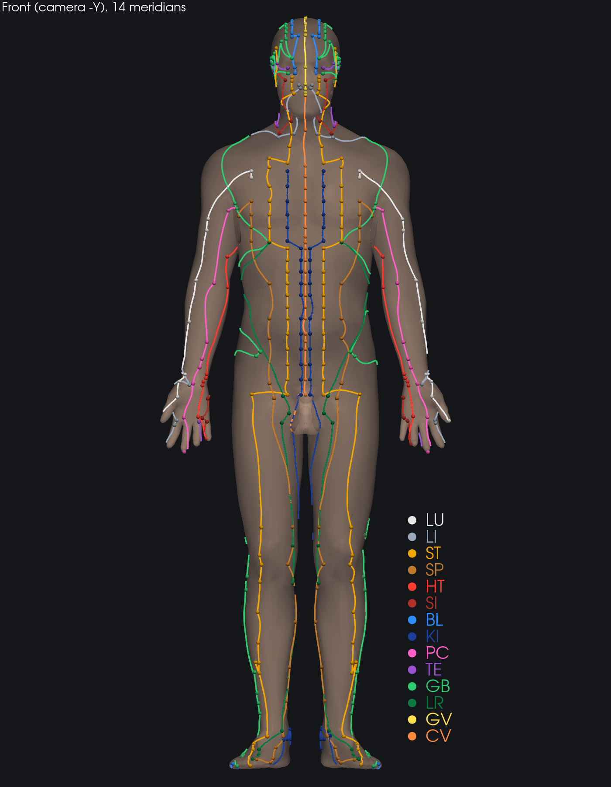

# 经穴与经络 3D 数据（BodyVista 人体）

362 个国标经穴（GB/T 12346-2021，含印堂 GV24+）在 [BodyVista](https://github.com/FreedomIntelligence/BodyVista) 人体模型皮肤上的三维坐标，以及 14 条经络贴着皮肤走的折线路径。可以直接在 Three.js 等引擎里叠加到 BodyVista 的 `full_body.glb` 上显示。

> 本数据只用于展示经络穴位的结构和文化，不涉及疗效，也不能作为针灸、按摩等操作的定位依据。精度见下文「精度」一节。



## 本仓库不含人体模型

人体模型**没有**随仓库分发。BodyVista 模型中大部分结构的来源标签带有 "NC exceptions; research only"（部分上游来源禁止商用），BodyVista 自己也注明这些许可尚待逐项核实。所以这里只发布坐标数据。使用时请自行从 BodyVista 获取模型：

```
python -I pipeline/fetch_upstream.py .
```

脚本会把固定 commit（`82b2ea1`）的 `assets/full_body.glb` 和 `catalog.json` 下载到 `vendor/BodyVista/`，并校验 sha256。模型的使用须遵守 BodyVista 及其上游的许可，见 [THIRD_PARTY_NOTICES.md](THIRD_PARTY_NOTICES.md)。

## 文件

| 文件 | 内容 |
|---|---|
| `data/acupoints.json` | 671 条记录：309 个双侧穴 × 左右 + 53 个任督正中穴（含印堂）。每条有 `code`（国标写法，如 `LU1`、`GV24+`）、`name`（简体）、`pinyin`、`meridian`、`meridianName`、`side`（L/R/C）、`xyz`、`normal`（皮肤外法线）、`accuracy`、`accuracyNote`、`asymmetryMm`、`skinDistMm` |
| `data/meridians-paths.json` | 26 条经（12 正经 × 左右 + 任脉 + 督脉），共 34 个笔画（分支）、7768 个点。每个笔画有 `codes`（途经穴位）、`acupointIndex`（每个穴位在 `points` 里的下标）、`points` |
| `data/acupoint-names.json` | 362 个经穴的编码、名称、拼音，按经排列（只有名称，不含国标定位条文） |
| `data/meridian-strokes.json` | 每条经的穴位连线顺序（笔画/分支） |
| `docs/check/*.png` | 15 张离屏核对图：正面、背面、左右侧面、头面部（正/侧/后）、手臂内外侧、手掌/手背、腿内外侧、足内外侧 |
| `pipeline/` | 全部计算脚本，以及中间结果 `transform_struct.json`（坐标变换）、`solved_furia.json`（锚点坐标系下的原始解）、`paths_report.json`、`solve.log` |

## 坐标系

- 输出全部在 **BodyVista 世界坐标**：Z 朝上，正面朝 −Y，人体左侧在 +X，单位与 GLB 相同（身高约 2.53）。
- 在 Three.js 里加载 `full_body.glb` 后，不做任何变换，直接按 `xyz` 放点即可对齐。

## 方法

穴位锚点来自 acupuncture-3d 项目（作者 Paweł Turzyński）：361 个穴位按「体段 + 寸 + 方位角」写成比例锚点，建立在 Z-Anatomy 人体上。BodyVista 用的是同一具 Z-Anatomy 人体，两者只差一个相似变换。

1. **坐标变换**：用 52 块骨/结构的包围盒中心做 Umeyama 相似变换拟合，`xyz_bv = s · R · xyz_furia + t`，s = 1.4733805，R ≈ 绕 Z 轴转 180°，t = [0.0000076, 0.0180606, −1.2627966]。52 个结构的残差全部 ≤ 0.2 mm（按真人尺寸）。
2. **自己重写解析器**：没有使用 acupuncture-3d 的任何代码，只读它的数据，在 `pipeline/body.py` 里重新实现体段轴线、寸尺、按方位角/旁开寸向外打射线、骨缘＋旁开、骨性结构锚点、头皮沿皮肤行走等。
3. **皮肤用外层壳**：BodyVista 的皮肤是双层网格（相距约 4.5 mm），只用外层求交、取最近点和法线。
4. **左右各算各的**：左侧在镜像身体上计算后再镜像回来，左右穴位各自落在自己那一侧的真实皮肤上。`asymmetryMm` 记录两侧的镜像差。
5. **骨骼与皮肤的错位校正**：骨骼（Z-Anatomy）和皮肤（BodyParts3D）四肢末端对不上。小腿胫腓骨整体前移约 42 mm；手部先做刚体 ICP，再把每根手指转向并缩放到皮肤上的指尖；足部平移后对每个脚趾做 ICP。
6. **按国标条文修正**：ST3、ST5、ST6、ST7、ST8、GB2、GB3、GB4、GB5、GB6、GB14、GB21、GB40、LI16、KI3、KI5、KI6、HT1 的源锚点与国标定位明显不符，按条文重新定位，原因写在 `accuracyNote` 里。移动最大的是 LI16（约 10.8 cm）、GB21（约 5.8 cm）、ST8（约 5 cm）。
7. **印堂 GV24+**：取左右攒竹（BL2）连线中点，在正中矢状面内投到皮肤。
8. **正中线穴位**（任督两脉）：在矢状面内投回 x = 0 的皮肤。
9. **经络路径**：相邻穴位之间，在细分一次的外层皮肤网格边图上求 Dijkstra 最短路，按 0.008（约 5.4 mm）重采样，固定穴位端点做拉普拉斯平滑并投影回皮肤（6 轮），最后沿外法线抬高 0.002（约 1.4 mm）防止 z-fighting。手阳明在人中交叉到对侧的走法没有做。

## 精度

| accuracy | 记录数 | 含义 |
|---|---|---|
| high | 462 | 寸法锚点，射线直接命中皮肤 |
| medium | 188 | 骨性结构定位、骨缘定位、按国标重算、轴向截断，或左右差 > 8 mm |
| low | 21 | 见下表 |
| failed | 0 | — |

整体误差估计：躯干和四肢的寸法穴在毫米到 1 cm 量级；手足和面部的骨性穴 1–2 cm；下表所列的穴误差更大。所有输出点都在外层皮肤上，没有落在体内的点。

| 穴位 | 问题 |
|---|---|
| HT1 极泉 | 模型的上臂和胸壁在腋下互相穿插，腋窝被封住，点比真实腋窝顶低约 5–10 cm，仅示意 |
| SI19、TE21、GB2、TE17、TE18、TE19、TE20、GB8、GB10 | 皮肤没有耳廓，改取最近的头侧皮肤点（离锚点 3–20 mm） |
| GV28 龈交 | 国标位置在上唇内，模型没有口腔内皮肤，放在上唇外表面正中 |

其他需要注意的：
- 手部穴位左右差较大（TE1 30 mm、SI1 26 mm、HT9 26 mm 等），原因是两只手的皮肤姿势不一样。
- CV1 会阴区网格很粗，可能偏前 1–2 cm。
- ST36–ST40、GB35–GB39 依赖胫腓骨与皮肤的平移校正；手足骨性穴误差约 1–2 cm。

## 复现

依赖见 `requirements.txt`（Python 3）。所有脚本都用 `python -I` 运行，第一个参数是仓库根目录，第二个是 `pipeline` 目录：

```
python -I pipeline/fetch_upstream.py .             # 0. 下载并校验 BodyVista 模型
python -I pipeline/fit_transform.py . pipeline     # 1. 拟合变换 -> transform_struct.json      （需要 acupuncture-3d）
python -I pipeline/solve.py        . pipeline     # 2. 解锚点 -> solved_furia.json            （需要 acupuncture-3d）
python -I pipeline/export.py       . pipeline     # 3. 转 BodyVista 坐标 -> data/acupoints.json
python -I pipeline/paths.py        . pipeline     # 4. 经络路径 -> data/meridians-paths.json
python -I pipeline/render.py       . pipeline     # 5. 核对图 -> docs/check/
```

**关于第 1–2 步**：acupuncture-3d 的 GitHub 仓库（`FuriaRozkwit/acupuncture-3d`）在 2026-11-19 已无法访问，本仓库不转发它的文件。第 1–2 步的结果已经作为中间文件附带，所以第 3–5 步只需要 BodyVista 就能重跑。如果你有该仓库 commit `7c4fd3f` 的副本，把 `data/points.json`、`meridians.json`、`rig_fitted.json`、`structures.json` 放进 `vendor/acupuncture-3d/data/`，`fetch_upstream.py` 会校验 sha256，然后就可以从第 1 步开始完整复现。

## 许可

- **数据**（`data/`、`docs/check/`、`pipeline/` 下的 `.json`/`.log` 中间结果）：[CC BY-SA 4.0](LICENSE-DATA)。这些数据由 Z-Anatomy 网格和 acupuncture-3d 的测量数据计算得出，按 share-alike 条款沿用同一许可。
- **代码**（`pipeline/*.py`）：[MIT](LICENSE)。
- 第三方来源、署名和修改说明见 [THIRD_PARTY_NOTICES.md](THIRD_PARTY_NOTICES.md)。

引用或改编时请注明本仓库，并保留 THIRD_PARTY_NOTICES.md 中列出的上游署名。
